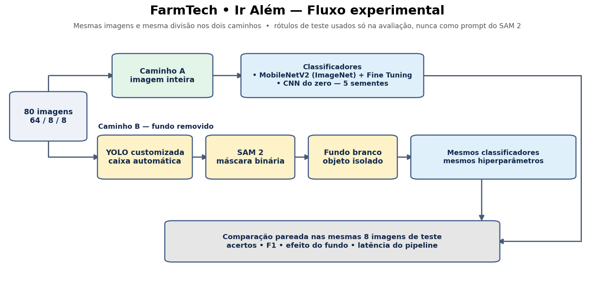
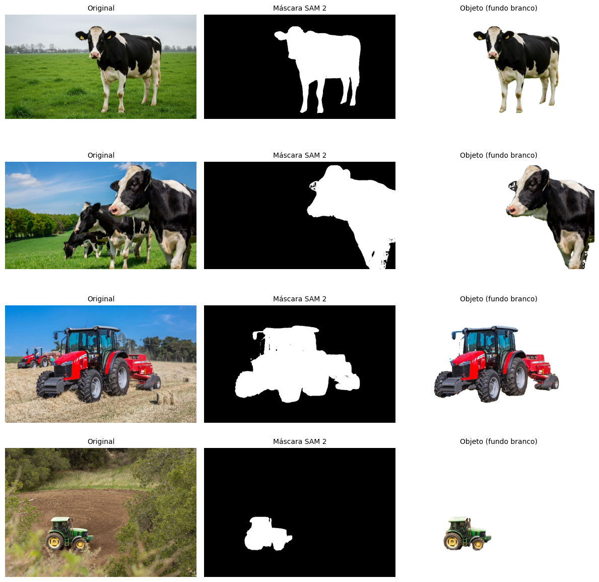
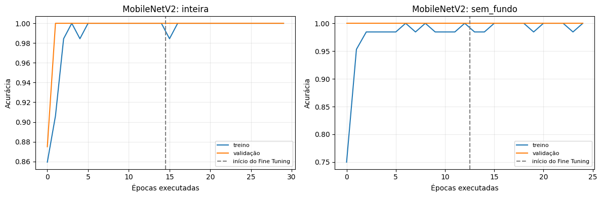
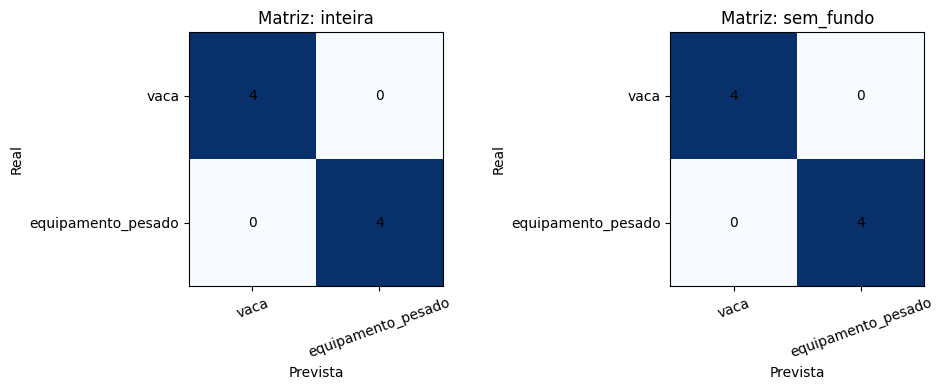
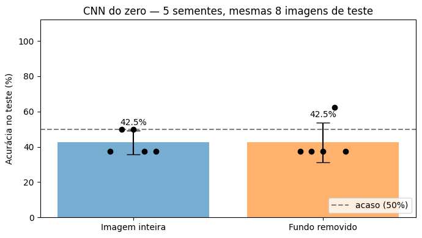

# Ir Além — Transfer Learning, Fine Tuning e segmentação automática

**FarmTech Solutions | FIAP — Fase 6**

**Integrantes:** Caroline Coelho Mendes (RM570370) · Leandro Paiva (RM572159) · Lucas Viana de Lima (RM571835)

[Voltar ao README principal](../README.md) · [Abrir o notebook executado](CarolineCoelhoMendes_rm570370_ir_alem_fase6.ipynb)

## Objetivo e hipóteses

Usamos as mesmas 80 imagens do projeto principal (64 treino, 8 validação, 8 teste) das classes **vaca** e **equipamento pesado** para investigar duas questões:

1. **Transfer Learning e Fine Tuning:** uma MobileNetV2 pré-treinada na ImageNet supera a CNN construída do zero na Entrega 2?
2. **Segmentação automática:** remover o fundo antes da classificação aumenta os acertos?

O caminho A classifica a **imagem inteira**. O caminho B usa **YOLOv5 customizada → caixa automática → SAM 2 → máscara → fundo branco → classificador**. Nos dois caminhos rodamos os mesmos classificadores (MobileNetV2 e CNN do zero), com a mesma divisão de dados e os mesmos hiperparâmetros. A seleção da caixa é automática: **as anotações reais de validação e teste nunca são usadas como prompts**.

## Metodologia e justificativas

**Por que MobileNetV2?** É uma arquitetura ImageNet com boas representações visuais e custo baixo: a base convolucional tem cerca de 2,3 M de parâmetros, contra cerca de 14,7 M da VGG16, o que reduz o risco de sobreajuste com 64 imagens de treino.

**Congelamento e Fine Tuning.** Na fase 1, toda a base fica congelada e só um classificador novo é treinado (learning rate 10⁻³). Na fase 2, liberamos as **30 últimas camadas** (de 154), que correspondem aos **blocos 14 a 16 e à convolução final** — os que combinam padrões em partes de objetos e precisam se adaptar a vacas e máquinas —, mantendo congelados os 13 primeiros blocos (bordas, cores, texturas, úteis para qualquer foto). Por serem as mais largas da rede, essas camadas concentram cerca de dois terços dos parâmetros da base; por isso o learning rate cai para 10⁻⁵ e o *early stopping* pela validação controla o sobreajuste. As camadas de **BatchNormalization ficam congeladas**, pois suas estatísticas da ImageNet seriam instáveis se recalculadas com lotes de 8 fotos. O notebook lista exatamente quais camadas e quantos parâmetros são liberados ([tabela](evidencias/camadas_fine_tuning.csv)).

**Pré-processamento.** 224 × 224 pixels, RGB, com `mobilenet_v2.preprocess_input`, que converte os pixels para `[-1, 1]`, a escala dos pesos ImageNet. Aumento de dados apenas no treino.

**Por que YOLO + SAM 2?** A YOLO treinada no domínio fornece a caixa do objeto principal; o SAM 2 transforma essa caixa em uma máscara de pixels, e o fundo é pintado de branco mantendo o enquadramento original.

## Resultados

| Abordagem | Acertos no teste | Acurácia | F1 macro | Treinamento |
|---|---:|---:|---:|---:|
| CNN do zero (Entrega 2) | 3/8 | 37,5% | — | 0,34 min |
| CNN do zero — imagem inteira (5 sementes) | 17/40 | 42,5% ± 6,8% | — | — |
| CNN do zero — fundo removido (5 sementes) | 17/40 | 42,5% ± 11,2% | — | — |
| **MobileNetV2 — imagem inteira** | **8/8** | **100%** | **100%** | 0,44 min |
| **MobileNetV2 — fundo removido** | **8/8** | **100%** | **100%** | 0,34 min |

Os 100% correspondem somente a oito imagens de teste. Inferência por imagem na GPU T4: ≈6 ms com a imagem inteira; ≈150 ms com fundo removido (YOLO + SAM 2 com mediana de ≈144 ms, mais a MobileNetV2).

Foram geradas máscaras válidas para as **80 imagens**, o que não significa contornos perfeitos: há pequenos buracos e recortes em regiões de cor parecida com o fundo ou de bordas finas.

### Evidências

**Original → máscara gerada pelo SAM 2 → imagem com fundo removido:**

**Curvas de Transfer Learning / Fine Tuning:**

**Matrizes de confusão das duas MobileNetV2:**

**CNN do zero com e sem fundo (5 sementes):**

## Análise crítica e recomendação

**Hipótese 1 — Transfer Learning (sustentada):** a MobileNetV2 acertou **8/8**, contra **3/8** da CNN do zero da Entrega 2 e média de **42,5%** da CNN do zero em 5 sementes. O resultado sustenta a utilidade prática das representações ImageNet nesta base, mas **não é uma prova causal isolada**, porque os modelos também diferem em arquitetura e resolução, e a amostra é pequena. A validação já chegou a 100% antes do Fine Tuning, então o ganho específico dessa etapa não é mensurável aqui.

**Hipótese 2 — Segmentação (não sustentada):** com a MobileNetV2, as duas versões ficaram em 100% — **efeito teto**, e essa comparação sozinha seria inconclusiva. Por isso repetimos o teste com a **CNN do zero**, que tinha margem para melhorar, em **5 sementes** por versão e com comparação pareada imagem a imagem. A remoção do fundo **não alterou a média** (42,5% nas duas versões): a máscara corrigiu 7 e prejudicou 7 dos 40 pares imagem × semente (p = 1,0), um efeito aleatório e não sistemático. A dificuldade da CNN do zero vinha da falta de dados para aprender do zero, não do fundo; e remover o cenário também retira pistas úteis, como pasto e lavoura. Além disso, a classe atribuída pela **própria YOLO** ao objeto principal acerta as 8 imagens de teste, e o caminho com segmentação é cerca de **25 vezes mais lento**, sem ganho de acertos.

**Recomendação para a prova de conceito:** usar a **MobileNetV2 com a imagem inteira** — mesmos acertos, uma rede só e resposta muito mais rápida — e validar em uma base maior e mais variada antes de implantar. A segmentação faz sentido quando o formato exato do objeto importa (por exemplo, estimar tamanho ou condição corporal do animal), não para esta classificação binária.

**Limitações:** oito imagens de teste (cada erro altera a acurácia em 12,5 pontos percentuais), cenas com anotações de detecção parciais, um único objeto principal escolhido automaticamente, possível propagação de erros entre YOLO, SAM 2 e classificador, e latências dependentes do ambiente. A segmentação é guiada por um detector treinado no domínio, não é independente.

## Reproduzir no Google Colab

1. Abra [`CarolineCoelhoMendes_rm570370_ir_alem_fase6.ipynb`](CarolineCoelhoMendes_rm570370_ir_alem_fase6.ipynb) no Colab e selecione GPU T4.
2. O notebook procura o dataset em `Meu Drive/FarmTech_Fase6/dataset_yolo`; se não o encontrar, usa um ZIP do projeto no Drive (inclusive o **Download ZIP** do GitHub), clona o repositório ou pede o upload do ZIP.
3. Execute em ordem. O notebook reutiliza a YOLO de 60 épocas em `Meu Drive/FarmTech_Fase6/resultados_revisao/yolo_custom/epocas_60/weights/best.pt`; se ela não existir, treina uma YOLO auxiliar sem usar as imagens de teste.
4. As saídas ficam em `Meu Drive/FarmTech_Fase6/resultados_ir_alem/`.

**Link do Colab:** [INSERIR LINK DO COLAB]

## Vídeo demonstrativo

**Link do vídeo:** (https://youtu.be/5vyjzbd4cBo)

## Referências técnicas

- [TensorFlow — Transfer Learning e Fine Tuning](https://www.tensorflow.org/tutorials/images/transfer_learning)
- [TensorFlow — MobileNetV2](https://www.tensorflow.org/api_docs/python/tf/keras/applications/MobileNetV2)
- [Keras — BatchNormalization e Fine Tuning](https://keras.io/guides/transfer_learning/)
- [Ultralytics — SAM 2](https://docs.ultralytics.com/models/sam-2)
