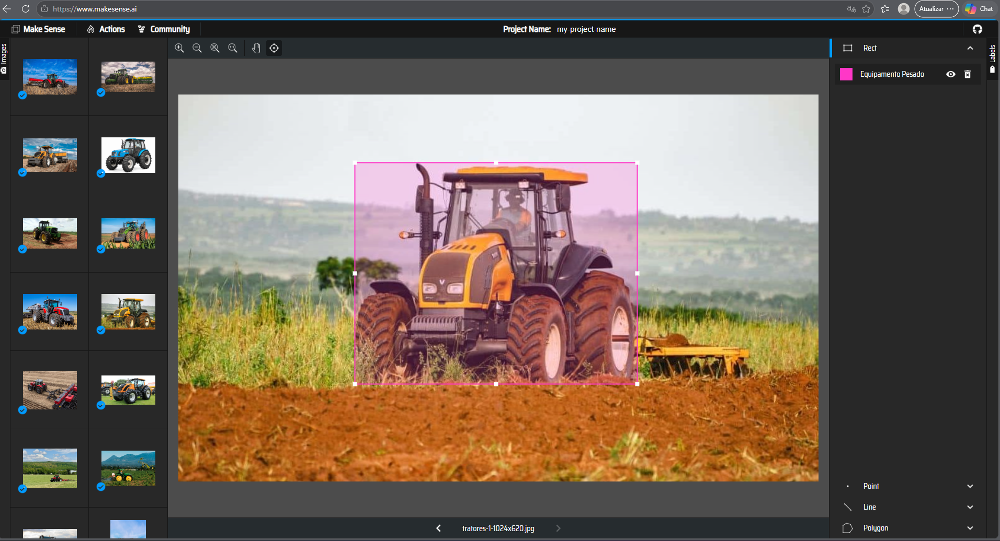
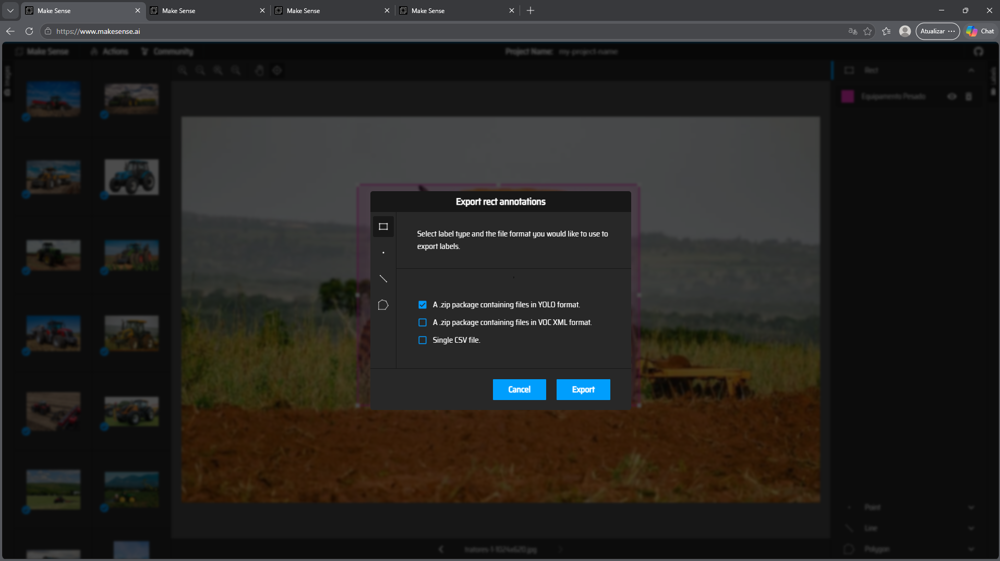
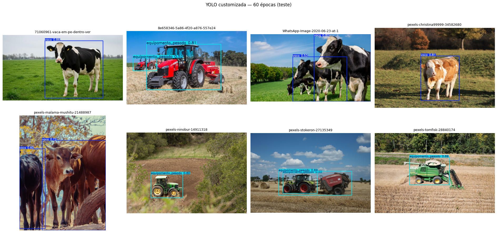
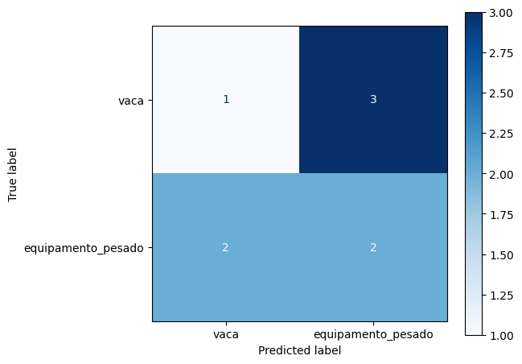

# FIAP - Faculdade de Informática e Administração Paulista

<p align="center">
  <a href="https://www.fiap.com.br/">
    
  </a>
</p>

<br>

# FarmTech Solutions — Fase 6 | O despertar da Rede Neural

## 👨‍🎓 Integrantes

- **Caroline Coelho Mendes** — RM570370
- **Leandro Paiva** — RM572159
- **Lucas Viana de Lima** — RM571835

## 👩‍🏫 Professores

### Tutor(a)
- **[INSERIR NOME DO(A) TUTOR(A)]**

### Coordenador(a)
- **[INSERIR NOME DO(A) COORDENADOR(A)]**

## 📜 Descrição

Projeto acadêmico da **FIAP** para a **FarmTech Solutions**, que aplica redes neurais e visão computacional ao monitoramento de ambientes rurais. O conjunto tem **80 imagens** (40 por classe), rotuladas no **Make Sense IA** e divididas em **64 de treino, 8 de validação e 8 de teste** (32 / 4 / 4 por classe), com as classes **`0 = vaca`** e **`1 = equipamento_pesado`** (máquinas agrícolas).

- **Entrega 1:** uma **YOLOv5s customizada** foi treinada com **30 e 60 épocas**, nas mesmas condições, para estudar como o número de épocas afeta as métricas de detecção e o custo de treino.
- **Entrega 2:** a YOLO customizada foi comparada com a **YOLOv5s padrão, pré-treinada no COCO**, e com uma **CNN de classificação treinada do zero**, quanto a facilidade de integração, precisão, tempo de customização e tempo de inferência.
- **Ir Além (opção 3.2):** **MobileNetV2 com Transfer Learning e Fine Tuning**, com imagens inteiras e com **fundo removido automaticamente por YOLO + SAM 2**; a hipótese da segmentação também foi testada com a CNN do zero em 5 sementes.

Este README integra as entregas; o passo a passo, o código comentado, as saídas executadas e a discussão completa estão nos notebooks.

### Etapas e evidências

| Etapa | Experimento | Onde está |
|---|---|---|
| Entrega 1 | YOLOv5s customizada — 30 × 60 épocas | [Notebook principal](CarolineCoelhoMendes_rm570370_pbl_fase6.ipynb), seções 2 a 5 |
| Entrega 2 | YOLO padrão × YOLO customizada × CNN do zero | [Notebook principal](CarolineCoelhoMendes_rm570370_pbl_fase6.ipynb), seções 6 a 11 |
| Ir Além | MobileNetV2 + Fine Tuning; com e sem segmentação YOLO/SAM 2 | [Notebook do Ir Além](Ir_Alem/CarolineCoelhoMendes_rm570370_ir_alem_fase6.ipynb) e [README específico](Ir_Alem/README.md) |

## 🏷️ Rotulação no Make Sense IA

As caixas foram desenhadas no [Make Sense IA](https://www.makesense.ai/) com a ferramenta *Rect* e exportadas em *Actions → Export Annotations → YOLO format* (um `.txt` por imagem, com coordenadas normalizadas). Os rótulos foram salvos no Google Drive, em `dataset_yolo/labels/`, e estão também neste repositório.





## 📊 Resultados da Entrega 1 — YOLO customizada

| Métrica | 30 épocas | 60 épocas |
|---|---:|---:|
| **mAP@0.5 — validação** | 96,4% | **98,1%** |
| **mAP@0.5 — teste** | 81,9% | **92,4%** |
| mAP@0.5:0.95 — teste | 55,5% | **63,7%** |
| Precision — teste | **91,1%** | 86,7% |
| Recall — teste | 57,5% | **78,6%** |
| Tempo de treinamento | 1,46 min | 2,01 min |

**Interpretação:** 60 épocas melhoraram o **mAP** na validação e, sobretudo, no teste, além do **recall**; a *precision* caiu levemente — o modelo encontra mais objetos ao custo de alguns alarmes a mais. Em uma avaliação adicional com confiança ≥ 0,25, as duas versões **empataram** com IoU ≥ 0,50 (8 TP, 4 FP, 1 FN; F1 **76,2%**), e a de 60 épocas venceu com IoU ≥ 0,75 (F1 **57,1%** contra 47,6%), indicando caixas mais justas. Note que o **mAP não é a porcentagem de imagens classificadas corretamente**, e que 8 imagens de validação saturam rapidamente perto do teto da escala.



Nas predições, os acertos típicos (vacas isoladas, tratores em campo aberto) aparecem com caixas justas, e a versão de 60 épocas é mais confiante. Os erros concentram-se em objetos encostados ou sobrepostos — com 60 épocas, trator e enfardadeira foram englobados em uma mesma caixa — e em grupos de animais. Parte dos “falsos positivos” são objetos reais que não haviam sido rotulados.

[Predições com 30 épocas](evidencias/predicoes_yolo_30_epocas.png) · [YOLO padrão](evidencias/predicoes_yolo_padrao_coco.png) · [Curvas da YOLO](evidencias/curvas_treinamento_yolo.png)

## 📈 Entrega 2 — comparação entre modelos

| Abordagem | Resultado de teste | Treinamento / customização |
|---|---|---:|
| YOLO customizada (30 épocas) | mAP@0.5: **81,9%** · F1 vaca: 80,0% | 1,46 min |
| **YOLO customizada (60 épocas)** | **mAP@0.5: 92,4%** · F1 vaca: 80,0% | 2,01 min |
| YOLO padrão (COCO) | F1 vaca: **66,7%** · máquinas detectadas como `truck` | sem treino adicional |
| CNN treinada do zero | Acurácia na classificação: **37,5% (3/8)** — abaixo do acaso | 0,34 min |

**YOLO padrão:** usamos a YOLOv5s com os pesos COCO originais — a mesma versão, resolução e limiar da YOLO customizada —, para que a comparação isole o efeito da customização. Ela é a mais simples de usar e encontra todas as vacas com caixas muito justas (inclusive as não rotuladas, o que reduz artificialmente seu F1), mas não tem uma classe para equipamento agrícola.

**CNN do zero:** classificador binário simples de integrar, mas com 64 imagens e sem pré-treinamento ficou abaixo dos 50% de um palpite. O Ir Além mostrou que a causa principal é a falta de dados para aprender do zero, e não o fundo das fotos.

**Tempo de inferência:** medido na seção 9 do notebook com aquecimento de todos os modelos, rodadas alternadas e mediana. As YOLOs de 30 e 60 épocas têm a mesma arquitetura e servem de controle do ruído da medição; todas as abordagens são rápidas o bastante para uso em tempo real na GPU, de modo que a escolha se dá pela capacidade de cada modelo, não pela velocidade.

**mAP (detecção), F1 (protocolo de detecção) e acurácia (classificação) não são a mesma métrica.** Os tempos pertencem ao Colab desta execução e podem variar.



[Curvas da CNN](evidencias/curvas_treinamento_cnn.png)

## 🚀 Ir Além — Transfer Learning e segmentação automática

A **MobileNetV2 pré-treinada na ImageNet**, com classificador novo e Fine Tuning das últimas 30 camadas (BatchNormalization congelada), foi aplicada às mesmas imagens de teste em duas versões: imagem inteira e fundo removido.

| Classificação | Acertos | Acurácia no teste | F1 macro | Treinamento |
|---|---:|---:|---:|---:|
| CNN do zero (Entrega 2) | 3/8 | 37,5% | — | 0,34 min |
| CNN do zero — 5 sementes, imagem inteira | 17/40 | 42,5% (média) | — | — |
| CNN do zero — 5 sementes, fundo removido | 17/40 | 42,5% (média) | — | — |
| **MobileNetV2 — imagem inteira** | **8/8** | **100%** | **100%** | 0,44 min |
| **MobileNetV2 — fundo removido** | **8/8** | **100%** | **100%** | 0,34 min |

<sub>Os 100% correspondem a apenas oito imagens de teste. Inferência por imagem na GPU T4: ≈6 ms com a imagem inteira contra ≈150 ms com fundo removido, que soma YOLO + SAM 2 + MobileNetV2.</sub>

**Hipótese 1 (Transfer Learning) — sustentada:** a MobileNetV2 acertou 8/8, enquanto a CNN do zero ficou em média em 42,5% (5 sementes). A diferença é grande e consistente, compatível com o benefício do pré-treinamento, embora arquitetura e resolução também mudem.

**Hipótese 2 (segmentação) — não sustentada:** com a MobileNetV2, as duas versões acertaram 8/8 (efeito teto). Com a **CNN do zero em 5 sementes**, que tinha margem para melhorar, a remoção do fundo **não mudou a média** (42,5% nas duas versões): a máscara corrigiu 7 e prejudicou 7 dos 40 pares imagem × semente ([gráfico](Ir_Alem/evidencias/cnn_zero_com_sem_fundo.png)). Além disso, a própria YOLO usada para a segmentação já acerta a classe das 8 imagens de teste, e a cadeia segmentada é cerca de 25 vezes mais lenta.

**Recomendação para a FarmTech:** nesta prova de conceito, usar a MobileNetV2 com a imagem inteira para classificação — mesmos acertos, uma rede só e resposta muito mais rápida — e a YOLO customizada quando for preciso localizar e contar objetos. Antes de qualquer uso real, ampliar e diversificar o dataset e reavaliar os modelos.


[Curvas de Transfer Learning](Ir_Alem/evidencias/curvas_transfer_learning.png) · [Matrizes de confusão](Ir_Alem/evidencias/matrizes_confusao.png) · [Comparação de acurácia](Ir_Alem/evidencias/comparacao_acuracia.png) · [Métricas CSV](Ir_Alem/evidencias/metricas_resumidas.csv)

**Detalhamento completo:** [README do Ir Além](Ir_Alem/README.md) e [notebook executado](Ir_Alem/CarolineCoelhoMendes_rm570370_ir_alem_fase6.ipynb).

## ⚠️ Limitações

A avaliação final contém apenas **8 imagens** (cada erro altera a acurácia em 12,5 pontos percentuais). Algumas cenas têm objetos reais sem rótulo, o que gera falsos positivos aparentes nas avaliações por caixas. A classe de equipamentos é visualmente heterogênea, e a escolha automática do objeto principal na segmentação pode falhar fora desta amostra. A YOLO padrão (COCO) não contempla a classe proposta, e os resultados não garantem desempenho em novas fazendas. **Trata-se de uma prova de conceito acadêmica.**

## 📁 Estrutura de pastas

```text
.
├── README.md
├── CarolineCoelhoMendes_rm570370_pbl_fase6.ipynb   # Entregas 1 e 2
├── requirements.txt
├── manifest.csv                                    # inventário das 80 imagens e rótulos
├── dataset_yolo/
│   ├── data.yaml
│   ├── images/{train,val,test}/
│   └── labels/{train,val,test}/                    # rótulos exportados do Make Sense IA
├── evidencias/                                     # prints, curvas, matriz de confusão, tabelas
└── Ir_Alem/
    ├── README.md
    ├── CarolineCoelhoMendes_rm570370_ir_alem_fase6.ipynb
    ├── figura_metodologia.png / .svg               # fluxograma autoral
    └── evidencias/                                 # máscaras, curvas, matrizes, métricas
```

Este repositório adapta as seções do [template FIAP `agodoi/templateFiapVfinal`](https://github.com/agodoi/templateFiapVfinal) à organização real do projeto.

## 🔧 Como executar o código

**Requisitos:** [Google Colab](https://colab.research.google.com/), Google Drive, internet para baixar dependências e pesos e, preferencialmente, **GPU T4**.

1. Abra o [notebook principal](CarolineCoelhoMendes_rm570370_pbl_fase6.ipynb) no Colab e selecione **GPU T4**.
2. Execute as células em ordem. O notebook procura o dataset em `Meu Drive/FarmTech_Fase6/dataset_yolo`; se não o encontrar, usa um ZIP do projeto no Drive (inclusive o **Code → Download ZIP** deste repositório), clona este repositório ou pede o upload do ZIP.
3. Para o Ir Além, abra o [notebook correspondente](Ir_Alem/CarolineCoelhoMendes_rm570370_ir_alem_fase6.ipynb). Ele reutiliza a YOLO de 60 épocas salva pelo notebook principal; se ela não existir, treina uma YOLO auxiliar sem usar as imagens de teste.
4. Os resultados ficam em `Meu Drive/FarmTech_Fase6/resultados_revisao/` (principal) e `.../resultados_ir_alem/` (Ir Além). Os notebooks deste repositório **já contêm as saídas executadas**.

### 📓 Acesso direto aos notebooks no Colab

- **Entregas 1 e 2:https://colab.research.google.com/drive/1J4nYCn0zWLhKdVcVi9-hRl3UNokxOhtz?usp=sharing
- **Ir Além:** https://colab.research.google.com/drive/1jGgIC_1SOY7aWIIEG3KrN9d9eccyAqRe?usp=sharing

### 🎥 Vídeos demonstrativos

- **Entregas 1 e 2: (https://youtu.be/DgPUIjEyt3w)
- **Ir Além:** (https://youtu.be/5vyjzbd4cBo)

## 🗃 Histórico de lançamentos

- **Entrega 1:** dataset de 80 imagens rotuladas no Make Sense IA e comparação YOLO 30 × 60 épocas.
- **Entrega 2:** YOLO padrão (COCO) e CNN do zero; comparação crítica pelos quatro critérios.
- **Ir Além:** MobileNetV2 + Fine Tuning, segmentação automática YOLO/SAM 2 e teste da hipótese da segmentação com a CNN do zero em 5 sementes.

## 📋 Licença

O README foi **adaptado do [template FIAP de agodoi](https://github.com/agodoi/templateFiapVfinal)**, licenciado em [Creative Commons Attribution 4.0](https://creativecommons.org/licenses/by/4.0/). O crédito é atribuído aos autores do template. Isso não licencia automaticamente as imagens de terceiros, códigos ou modelos usados neste projeto.
